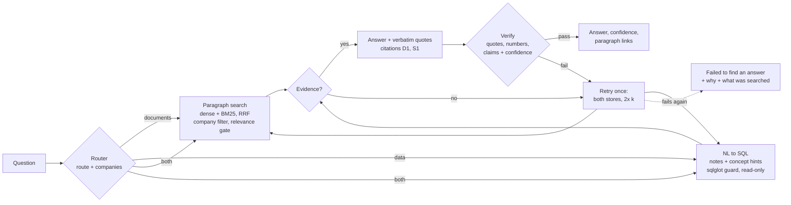
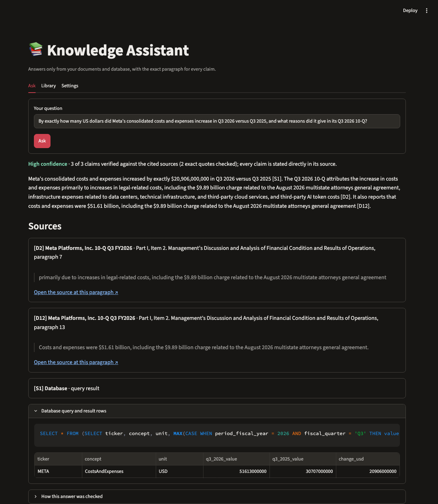
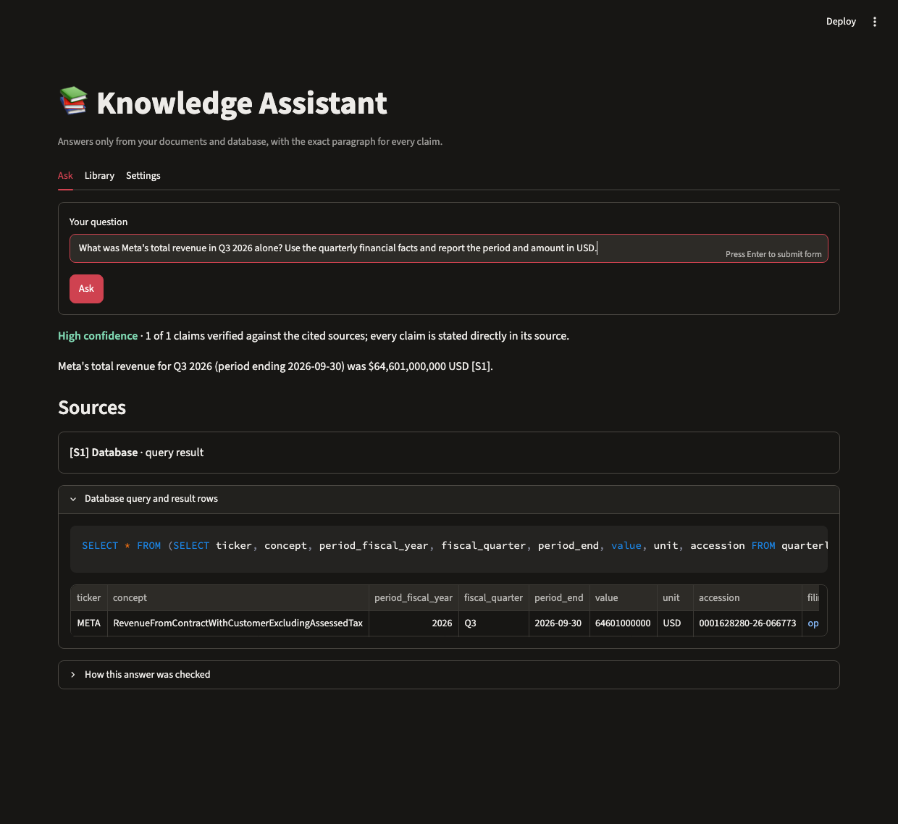
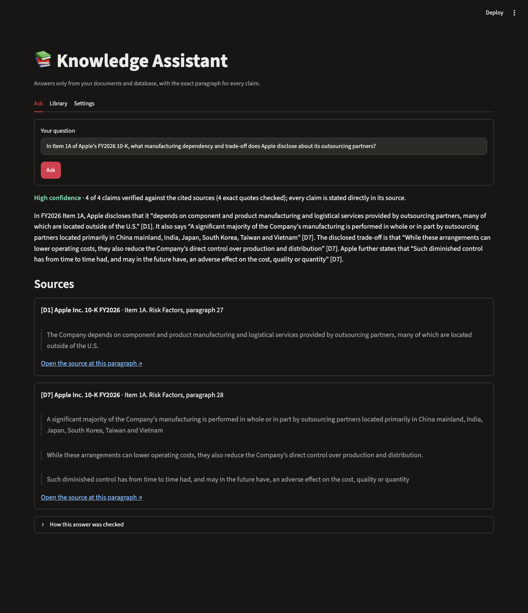
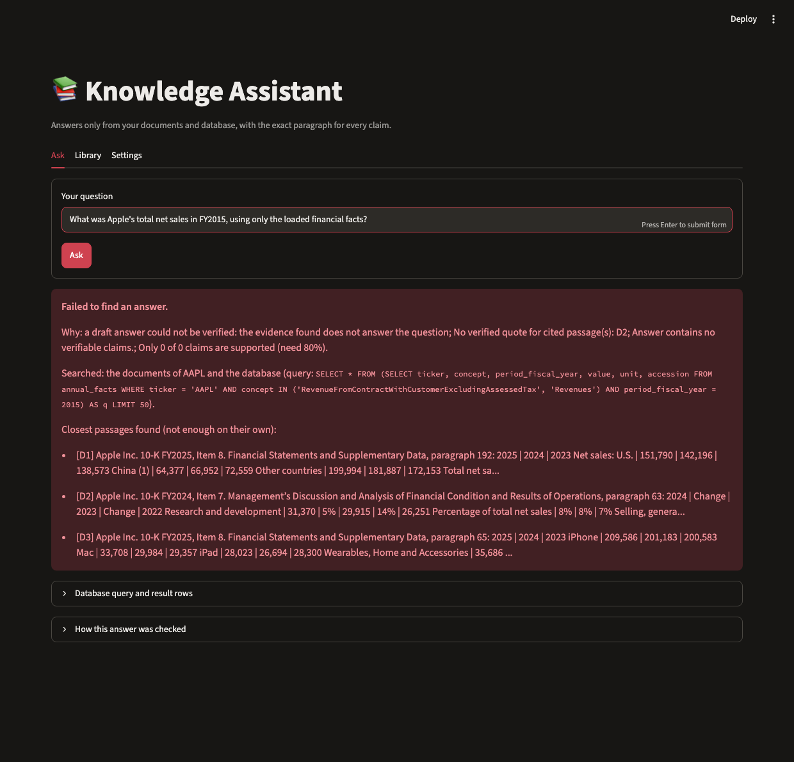

# Knowledge Assistant: verified answers from documents + data

Ask a question in plain English. The assistant answers from your **documents** (10-K filings,
PDF/Word policies) and your **database** (financial facts, tables). Document citations link to
the supporting passage and include a checked quote. Structured answers show the SQL results.
When the evidence or validation is insufficient, the assistant can abstain and explain why.

The demo data is real: **Apple's and Meta's 10-K annual reports** plus Meta's latest **10-Q** quarterly
report (text), and their **XBRL financial facts** (about 5 years of figures) from SEC EDGAR. The 8 public
files ship in `data/docs/`, so the demo runs as soon as a model key is set.

| The brief asks for | Where |
|---|---|
| Ingestion / indexing of documents, querying SQL data | `km ingest` (§5 Ingestion), `src/km/retrieval/sql.py` (§5 Structured retrieval) |
| Routing by intent: structured / unstructured / hybrid | §5 Routing, `src/km/router.py` |
| Groundedness / validation, and what happens when evidence is insufficient | §3, `src/km/validate.py` |
| How to run locally (setup, commands, env vars) and example queries | §1, §8, §9 |
| Architecture, key design decisions | §5, §6 |

---

## 1. Quick start (no terminal)

For a fresh machine or assessment handoff, use the [portable setup](PORTABLE.md) with Python 3.12.

1. Install **Python 3.10+** from [python.org](https://www.python.org/downloads/) (one time).
2. Double-click **`start.command`** (Mac) or **`start.bat`** (Windows).
   - The first run installs everything into `.venv` (a few minutes). Later runs start in seconds.
   - Mac: the first time, right-click → **Open** to allow it, because it's a downloaded script.
   - Mac: double-clicking again restarts the app with the latest code (an open copy is stopped first), and it reinstalls by itself if the folder moved or `pyproject.toml` changed.
3. Your browser opens the app at `http://localhost:8501`. It has three tabs:

| Tab | What you do there |
|---|---|
| **Settings** | Pick the model provider (Azure OpenAI / OpenAI / internal gateway / OpenRouter / Bedrock), paste the key, **Save**, then **Test connection**. Settings are stored only on this computer, in `.env`. |
| **Library** | Drag in 10-K / 10-Q `.htm` files, PDFs, Word files and SEC `CIK*.json` files, then click **Build index** (a progress bar shows). No files yet? **Load demo data**. |
| **Ask** | Type a question. You get the answer, a **High / Medium / Low confidence** badge with its reason, and each source with its quote and a link to the paragraph. |

Without a key the app runs in **offline demo mode**. Answers are then quoted extracts, and database
questions only work on the demo data. Real use needs a model (see §4).

## 2. The Apple / Meta data (included; how to refresh it)

The repository already contains these files in `data/docs/`. To refresh or add years, download them by
hand (about 5 minutes); the Library tab shows the same instructions with clickable links.

1. **10-K documents.** Open the filing list for
   [Apple](https://www.sec.gov/cgi-bin/browse-edgar?action=getcompany&CIK=0000320193&type=10-K) or
   [Meta](https://www.sec.gov/cgi-bin/browse-edgar?action=getcompany&CIK=0001326801&type=10-K).
   For each of the last 3 years:
   - open the 10-K and then its main `.htm` document (e.g. `aapl-20240928.htm`);
   - if it opens in the "Inline XBRL viewer", use *Menu → Open as HTML*;
   - save it with *File → Save Page As → "Web Page, HTML Only"* and **keep the file name**, which is used to build the link back to sec.gov (a browser renaming `.htm` to `.html` is fine).
   - If the latest year's 10-K isn't out yet, add the latest **10-Q** the same way (`type=10-Q` in the link). The demo uses Apple FY2024–2026 10-Ks, Meta FY2024–2025 10-Ks and Meta's Q3 2026 10-Q.
2. **Financial facts**, one file per company:
   [Apple `CIK0000320193.json`](https://data.sec.gov/api/xbrl/companyfacts/CIK0000320193.json) ·
   [Meta `CIK0001326801.json`](https://data.sec.gov/api/xbrl/companyfacts/CIK0001326801.json).
3. Drop all the files (6 filings + 2 JSON) into **Library**, click **Save to library**, then **Build index**.

There is no manifest to write. Each 10-K / 10-Q carries hidden XBRL `dei:` tags (company, ticker, CIK,
fiscal year, quarter), which the app reads to match each document to its filing and its financial facts.

## 3. What "verified" means

| Check | Kind | When it fails |
|---|---|---|
| Every cited quote appears **word for word** in the cited paragraph | deterministic | answer blocked |
| Every cited paragraph has at least one verified quote | deterministic | answer blocked |
| Every citation points to evidence that was actually retrieved | deterministic | answer blocked |
| Every **number** appears in a database result row, or in a cited paragraph that has a verified quote (never its label line, so "Item 7" doesn't vouch for "7%"). Scale-aware: "$391.0 billion" = 391035000000, and = "391,035" in a filing table stated in millions. Never taken from the SQL text itself. | deterministic | answer blocked |
| Each claim really follows from its source (LLM judge) | model-judged | shown as the **confidence level** |

- **Confidence:**
  - The judge rates every claim from 0 to 1, with a one-sentence reason:
    - stated word for word or as an exact figure: about 1.0;
    - faithful paraphrase: about 0.8;
    - needs an inference: 0.6 or lower.
  - The answer's confidence is its **weakest** claim: **High** ≥ 0.85, **Medium** ≥ 0.6, **Low** below that.
  - The explanation names that weakest claim, e.g. *"4 of 4 claims verified (3 exact quotes checked); weakest: '…' (0.62): needs an inference from [D3]"*.
- **Failure:**
  - If the checks fail, the system retries once (both stores, twice as many passages, plus the judge's feedback).
  - If that also fails, the user sees **"Failed to find an answer."**, followed by **why** (e.g. "the database query returned no rows", "a draft answer could not be verified: …"), **what was searched**, and the closest passages it did find.
  - Every run, including errors, is appended to `logs/audit.jsonl`.

What this does **not** guarantee: the model-judged step can be wrong about meaning. For example, it
may misjudge whether a paraphrase is fair. That is why it is shown as a confidence level rather
than hidden. The references themselves are checked mechanically.

## 4. Which LLM is enough

- **Tested for this demo:** OpenRouter with `deepseek/deepseek-v4.1-flash-1017` for every step (routing, SQL, answer, fact-check) and `qwen/qwen3-embedding-8b` for embeddings (results in §10). One question costs well under a cent.
- **For a bank deployment:** one mid-tier GPT model on Azure OpenAI (GPT-4o / GPT-4.1 class or newer) with `text-embedding-3-large`. Same code path, chosen in Settings; not run live here.
- **A mini model** (GPT-4o-mini / 4.1-mini class) also works. It writes weaker SQL and paraphrases more instead of quoting exactly, so more questions end in "Failed to find an answer". **Wrong answers still do not get through**, because the reference and number checks are deterministic. A bigger model buys coverage, not correctness.
- **Must have:** function calling / structured output. Every current GPT model on Azure supports it. About 16k tokens of context is plenty.
- **Reasoning models** (o-series, GPT-5 family) work too, but are slower and cost more. Tick *"the model rejects the temperature setting"* in Settings.
- **OpenRouter:** pick *OpenRouter* in Settings and paste one key; it serves both the chat model and the embeddings. The defaults are the tested pair: `deepseek/deepseek-v4.1-flash-1017` ($0.15 / $0.60 per million input / output tokens) and `qwen/qwen3-embedding-8b`. `openai/text-embedding-3-large` (also offered by Azure OpenAI) ranked about as well in an A/B test (`eval/SEC_EMBEDDING_AB.md`); `openai/gpt-4.1` is a stronger chat alternative; any other model id from openrouter.ai works if it supports structured outputs (requests are only routed to upstreams that do). A new embedding model needs one **Rebuild index**; each model's index is saved separately, so switching back (e.g. offline ↔ OpenRouter) needs no rebuild. Models with a thinking mode (DeepSeek V4.1) answer with thinking **off** by default: about 5-10 s per question instead of 15-45 s, with the same accuracy on the test sets; a Settings checkbox turns it back on. Each model call has a 60 s limit.

## 5. How it works



**Ingestion** (the **Build index** button, or `km ingest`)
- **One chunk = one paragraph**, so a reference is always a precise paragraph.
  - **10-K / 10-Q `.htm`:** hidden XBRL headers are dropped. Paragraphs and tables are numbered within each **Item** (Item 1A, Item 7, …), and every table becomes one block. Page footers and the table of contents are skipped. A 10-Q restarts at Item 1 in Part II, so its headings carry the Part (`Part II, Item 1A. Risk Factors`).
  - **PDF:** paragraphs are numbered per page.
  - **Word:** paragraphs are numbered per heading.
  - **Text:** paragraphs are separated by blank lines.
  - Paragraphs longer than 1,500 characters (big tables) are split into parts.
- Each chunk gets a header line used for search, e.g. `Apple Inc. 10-K FY2024 (fiscal year 2024) | Item 1A. Risk Factors, paragraph 28`. Its id looks like `aapl-20240928.htm::item-1a::p28`.
- Chunks are embedded into **Chroma**, and the same text is kept for **BM25** keyword search.
- The index is saved per embedding model (`.index/<provider_model>/`, e.g. `.index/openrouter_qwen_qwen3-embedding-8b/`) and reused across restarts. Rebuild only when the documents change or a model is used for the first time. The SQLite database is shared.
- **SEC facts** (`src/km/sec.py`): `CIK*.json` is loaded into SQLite, keeping **only facts from the 10-Ks / 10-Qs in the library**, so every number traces to a document you have.
  - `filings(accession, ticker, fiscal_year, report_date, url, …)`
  - `facts(ticker, concept, label, unit, value, period_start, period_end, period_fiscal_year, accession, …)`
  - view `annual_facts`: 10-K full-year and point-in-time values, de-duplicated with the latest filing winning, so restatements apply.
  - view `quarterly_facts`: 3-month periods from 10-Qs with `fiscal_quarter` (Q1–Q3). 10-Q year-to-date totals and quarter-end balances stay in `facts`.
  - `period_fiscal_year` fixes a common XBRL pitfall: `fy` is the *filing's* year. Apple's FY2022 revenue appears in its FY2024 10-K tagged `fy=2024`.
  - `km_notes` holds usage hints for the SQL writer ("values are raw USD, not millions").
  - `km_glossary` maps concept tags to labels and descriptions, for concept lookup.

**Routing** (`src/km/router.py`)
- The LLM sees the database schema and the document catalog. It returns `structured | unstructured | hybrid`, a confidence, focused sub-questions and the **companies** involved.
- The companies become a hard filter on paragraph search, so an Apple question never cites a Meta paragraph.
- Low confidence (< 0.6) means hybrid: searching both stores is cheap; missing evidence is not.
- If no database is loaded, the route is forced to documents only, and vice versa.
- Without a model (offline demo) a transparent keyword classifier routes instead: data cues ("how many", "total", "revenue", "net income") → structured, policy cues ("policy", "why", "risk", "describe") → unstructured, both or a comparison cue → hybrid, nothing clear → hybrid.

**Document retrieval** (`src/km/retrieval/docs.py`)
- Two rankings per question: meaning (embeddings in Chroma) and keywords (BM25), merged with Reciprocal Rank Fusion. The top 3 of each ranking are always kept, because fusion alone dropped a paragraph ranked #1 on meaning but #111 on keywords.
- 12 paragraphs go to the answer writer (`TOP_K`). A question about two companies is searched once per company (12 each), so one company cannot crowd the other out of a comparison.
- A relevance gate drops paragraphs that are neither close in meaning nor share the question's words. A question with no English words (e.g. Chinese) skips the keyword ranking instead of returning nothing.
- Qwen3 embedding models get their task instruction in front of the *question* only (`QUERY_INSTRUCTIONS` in `src/km/llm/providers.py`), as the model's authors recommend; documents are embedded as they are.
- Measured on `eval/sec_embedding_ab.yaml` with `qwen/qwen3-embedding-8b`: all required paragraphs found for 11 of 11 questions (8 of 11 before these rules).

**Structured retrieval** (`src/km/retrieval/sql.py`)
- The SQL writer sees only the schema, never row data, plus the `km_notes` hints, the 25 best-matching glossary terms and (for glossaries up to 1,000 terms) the full list of tag names. That is how it finds tags like `RevenueFromContractWithCustomerExcludingAssessedTax` (Apple) versus `Revenues` (Meta).
- Safety checks:
  - `sqlglot` allows exactly one `SELECT`;
  - tables and views must be on an allow-list;
  - dangerous functions are blocked;
  - a row `LIMIT` is always enforced;
  - the connection is read-only, with a time budget;
  - a failed query gets one repair attempt.

**Generation and validation** (`src/km/generate.py`, `src/km/validate.py`)
- The model returns the answer with `[D1]`/`[S1]` citations, plus a list of verbatim quotes for each cited paragraph.
- If a quote is word for word in exactly one retrieved paragraph but the model labelled it with the wrong id, the citation is pointed at the paragraph that contains it. Database figures are shown to the model with thousands separators, so it does not misread long numbers.
- The fact-checker also decides whether the answer gives what the question asked for; "X is not mentioned, but Y is" becomes "Failed to find an answer".
- The checks in §3 then run on it.

## 6. Key design decisions

| Decision | Why |
|---|---|
| **Paragraph-level chunks + verbatim quotes** | A reference is only useful if it is precise and checkable. Quotes are verified by substring match, so a made-up reference can't pass. |
| **Text fragment links** (`url#:~:text=…`) | Chrome, Edge and Safari scroll to and highlight the quoted text on sec.gov, with no extra infrastructure. |
| **XBRL facts for numbers, filings for narrative** | Figures come from the companies' own tagged data (exact, with units and periods). The "why" comes from MD&A and risk-factor paragraphs. |
| **Deterministic checks first, model judgement second, shown as confidence** | Correctness of references and numbers doesn't depend on the model. The fuzzy part is made visible instead of hidden. |
| **"Failed to find an answer" with reasons** | Better than a blank or a guess. The reason tells the user whether to rephrase, add a document, or ask a data owner. |
| **LangGraph** | An explicit, testable state machine: route → retrieve → gate → generate → validate → retry/fail. |
| **Pluggable provider** (Azure OpenAI incl. keyless Entra ID, OpenAI / internal gateway, OpenRouter, Bedrock) | The bank's approved endpoint is a setting, not a code change. |
| **Streamlit web page + double-click launchers** | Non-technical users never need the terminal. |
| **Chroma + SQLite** | Zero infrastructure for a demo. In production: Azure AI Search / pgvector, and SQL Server / Postgres. |

## 7. Using your own data later

- **Documents:** drop any `.htm`, `.pdf`, `.docx`, `.txt` or `.md` files into the Library.
- **Database:**
  - point `DB_PATH` (in `.env`) at any SQLite file; its tables and views are discovered automatically.
  - Optionally add two small tables to help the SQL writer:
    - `km_notes(note)`: plain-language hints;
    - `km_glossary(term, description)`: codes and what they mean.
  - Tables starting with `km_` are hints only and are never queried.

## 8. How to run locally (terminal)

Python 3.10+ (tested on 3.12 and 3.13); macOS, Linux or Windows.

```bash
python -m venv .venv && source .venv/bin/activate      # Windows: .venv\Scripts\activate
pip install -c constraints.txt -e ".[dev]"             # tested versions; drop "-c constraints.txt" for the latest
pytest                                                 # offline tests, no key needed (78 tests, ~3 s)
```

**Offline demo (no key):** synthetic bank policies (PDF/Word) and a small SQLite database.

```bash
export DOCS_DIR=/tmp/km-demo/docs DB_PATH=/tmp/km-demo/km.db INDEX_DIR=/tmp/km-demo/index
km sample-data && km ingest
km ask "Are credit card complaint resolution times within the dispute policy SLA?"
```

**Live SEC demo (Apple / Meta):** put a key in `.env` (copy `.env.example`), or use the Settings tab.

```bash
cp .env.example .env        # then set OPENROUTER_API_KEY=... in it
km ingest                   # 6 filings -> 5,299 paragraphs + 2,730 financial facts (5-10 min once with Qwen, < $0.01; reused after that)
km ask "What were Apple's total net sales in FY2025 and FY2026?"
km ui                       # the web page at http://localhost:8501
```

| Environment variable | What it does |
|---|---|
| `LLM_PROVIDER` | `mock` (offline), `openrouter`, `azure_openai`, `openai`, `bedrock` |
| `OPENROUTER_API_KEY`, `OPENROUTER_CHAT_MODEL`, `OPENROUTER_EMBEDDING_MODEL` | OpenRouter key and models (defaults: DeepSeek V4.1 Flash, Qwen3-Embedding-8B) |
| `AZURE_OPENAI_ENDPOINT`, `AZURE_OPENAI_API_KEY` (empty = Entra ID), `AZURE_OPENAI_CHAT_DEPLOYMENT`, `AZURE_OPENAI_EMBEDDING_DEPLOYMENT` | Azure OpenAI |
| `EMBEDDING_PROVIDER` | a different provider for embeddings (default: same as `LLM_PROVIDER`) |
| `LLM_THINKING` | `true` lets models with a thinking mode think first (3-7x slower) |
| `DOCS_DIR`, `DB_PATH`, `INDEX_DIR`, `AUDIT_LOG` | where documents, the database, the index and the audit log live |
| `TOP_K`, `DOC_MIN_SIMILARITY`, `GROUNDEDNESS_THRESHOLD`, `SQL_MAX_ROWS` | search depth, relevance gate, validation pass mark, SQL row cap |

Commands: `km ui` (web page) · `km sample-data` · `km ingest` · `km ask "<question>" [--json] [--show-evidence]` ·
`km eval --file <cases.yaml> [--report out.json]`. On a Mac, `run_checks.command` runs the live SEC test set by double-click.

## 9. Example queries

Results from the live demo (DeepSeek V4.1 Flash + Qwen3-Embedding-8B); exact wording varies run to run.

| Question | Route | What comes back |
|---|---|---|
| What were Apple's total net sales in FY2025 and FY2026? | structured | $416,161,000,000 and $478,834,000,000, cited to the SQL rows `[S1]` with links to the 10-K |
| What was Meta's total revenue in Q3 2026 alone? | structured | $64,601,000,000 from `quarterly_facts` (the 10-Q) |
| In FY2025, how much net cash did Meta's financing activities provide or use? | structured | net cash **used**, $20,370,000,000 (the signed value is negative) |
| What dispute about outside chatbots and the WhatsApp Business API did Meta report in its Q3 2026 10-Q? | unstructured | the EU antitrust investigation and the June 2026 interim measure (free API access), quoted from the 10-Q |
| In Item 1A of Apple's FY2026 10-K, what manufacturing dependency does Apple disclose about its outsourcing partners? | unstructured | quotes from Item 1A with paragraph numbers and links that highlight the passage on sec.gov |
| By how much did Apple's income tax provision rise from FY2023 to FY2024, and what one-time event did Apple cite? | hybrid | +$13,008,000,000 computed in SQL `[S1]`, plus the $10.2 billion State Aid Decision charge quoted from Item 7 `[D1]` |
| Compare Apple's and Meta's FY2025 operating cash flow, with Apple's dividends and Meta's capex for context | hybrid | $111,482M vs $115,800M `[S1]`, and one quoted paragraph from each company's 10-K |
| What exact percentage of Meta's Q3 2026 advertising revenue came from Brazil? | hybrid | **Failed to find an answer**: the filings give "Rest of World", not Brazil |
| What is Apple's policy on employee pet insurance? | unstructured | **Failed to find an answer**, with the closest passages it found |
| What was Apple's revenue in fiscal 2015? | structured | **Failed to find an answer**: the loaded filings start at FY2022 |

Offline demo (no key): *"How many complaints were logged per category?"* (structured), *"What should I do if I
lose my laptop while working remotely?"* (unstructured), *"Are credit card complaint resolution times within the
dispute policy SLA?"* (hybrid), *"What is the bank's policy on cryptocurrency custody for retail clients?"* (fails).

## 10. Verification status and limitations

### Live results · 20 November 2026

OpenRouter run with `deepseek/deepseek-v4.1-flash-1017` and
`openai/text-embedding-3-large` on six SEC filings and 2,730 XBRL facts.

| Check | Result |
|---|---|
| Offline unit and integration tests | 78/78 passed |
| SEC acceptance fixture | 11/12 passed all checks |
| Initial route and answer/abstain status | 12/12 each |
| Final route where specified | 10/10 |

The cross-company net income response returned the correct SQL values for both companies. The fixture
flagged it because the two amounts appeared on the same line.

The retrieval-only comparison used the same chunks, questions, and retrieval settings in both arms.
Qwen used the SiliconFlow upstream through OpenRouter after the default route timed out.

| Embedding model | Top 8 complete evidence | MRR@8 |
|---|---|---:|
| `openai/text-embedding-3-large` | 10/11 | 0.614 |
| `qwen/qwen3-embedding-8b` | 9/11 | 0.649 |

Both arms missed the Apple buyback authorization evidence. Qwen also missed the Meta mobile-platform
risk passage. On this set, OpenAI found all required evidence for one more question, while Qwen had
the higher mean reciprocal rank.

In the seven end-to-end spot checks per arm, both arms answered six questions and abstained on the
missing Brazil figure. Qwen answered the cross-company cash flow question with both requested
document sources. The OpenAI-embedding run gave the correct operating cash flows but missed
Meta's property and equipment purchases. Qwen routed the Apple regional-sales document question
as hybrid, although the answer used the relevant FY2026 passage.

### Application screenshots

These screenshots were captured directly from the project's Streamlit Ask page using OpenRouter,
DeepSeek V4.1 Flash 1017 and Qwen3 Embedding 8B. The evaluation table above reports the separate CLI run.

**Hybrid** · SQL computes the year-over-year increase in Meta's quarterly costs and the 10-Q supplies management's explanation.



<details>
<summary>SQL, document and abstention screenshots</summary>

**Structured** · Meta Q3 2026 revenue with its period and SQL result.



**Unstructured** · Apple FY2026 manufacturing trade-offs with an Item 1A quotation.



**Abstention** · Apple FY2015 sales are outside the loaded financial facts.



</details>

### Additional checks and limitations

- **Tested offline** (`pytest`, 78 tests, mock mode):
  - 10-K / 10-Q HTML parsing (Items, 10-Q Parts, paragraph numbers, tables, hidden headers, footers, table of contents);
  - XBRL loading (fiscal-year mapping, 10-Q matched by quarter, de-duplication, only downloaded filings);
  - SQL safety;
  - every deterministic check, including fake quotes, invented numbers, numbers taken from SQL text, and scale matching;
  - confidence labels and explanations;
  - the retry → "Failed to find an answer" path;
  - routing, the company filter and one search per company;
  - `.env` saving, and that the Settings page never sends a saved key to the browser;
  - a headless end-to-end run of the web page.
- **Checked on real data:** Apple's FY2024 10-K (`aapl-20240928.htm`) and its `companyfacts` JSON:
  - 641 paragraphs across all 23 Items, parsed in about 0.4 s;
  - net income for FY2022–2024 mapped to the right fiscal years;
  - a risk-factor question answered with quotes and links to Item 1A, paragraphs 28 and 31.
- **Checked on the full demo set** (Apple FY2024–2026 10-Ks, Meta FY2024–2025 10-Ks, Meta Q3 2026 10-Q):
  5,299 paragraphs and 2,730 facts from 6 filings, with every filing linked to its sec.gov document. The 10-Q's
  Q3 revenue ($64,601M) agrees between the text and `quarterly_facts`.
- **Earlier demo runs** (OpenRouter, DeepSeek V4.1 Flash + Qwen3-Embedding-8B, thinking off):
  - `eval/sec_questions.yaml`, 12 questions incl. 2 that must fail: **12 of 12 answered or refused correctly**, every figure exact; the strict wording checks pass 8-11 of 12 per run (e.g. "January 1 to September 30" where the test wants "nine months").
  - `eval/sec_embedding_ab.yaml` (written separately as an independent check), 11 search questions with gold paragraphs: all required paragraphs retrieved for **11 of 11** (8 of 11 before the search rules in §5); its 9 end-to-end spot checks, incl. 2 refusal traps, all correct.
  - Speed: median **7-8 s** per question, slowest 27 s (thinking on: median 15 s, slowest 135 s).
- **Offline demo mode** checks that answers are *grounded*, but not that they are *relevant*. A vague question can get on-topic-looking quotes. With a real model, the generator and judge handle relevance.
- **Off-topic questions are refused by the fact-checker**, not the first relevance filter: Qwen scores most paragraphs as similar (0.6-0.8), so a refusal takes 13-19 s instead of a few seconds.
- **Text-fragment links** start at the first run of plain words in the quote. If the browser can't find it, the page opens at the top of the filing.
- **Security:** the web page listens on `localhost` only and never shows a saved key. Keys live in `.env` (git-ignored).
- **Not handled:** automatic SEC download (files are pulled by hand) and amendments (10-K/A, 10-Q/A). A Q1 10-Q of a company whose fiscal year doesn't end in December (e.g. Apple) labels its prior-year-end balances one year too late in `facts`.

### Re-running the evaluation sets

`eval/sec_questions.yaml` contains 12 cases for the six filings and both companyfacts JSON files.
The checks cover the initial and final routes, exact USD amounts, values that belong in the same
SQL row, document citations to the requested filing and section, and abstention.

From the repository root, build a separate benchmark index and database for both runs:

```bash
sec_eval_dir=$(mktemp -d)
export DB_PATH="$sec_eval_dir/km.db"
export INDEX_DIR="$sec_eval_dir/index"
export AUDIT_LOG="$sec_eval_dir/audit.jsonl"
mkdir -p logs

LLM_PROVIDER=mock EMBEDDING_PROVIDER=mock km ingest
LLM_PROVIDER=mock EMBEDDING_PROVIDER=mock km eval --file eval/sec_questions.yaml --report logs/sec-mock.json

# After selecting a live model and saving its credentials in Settings:
EMBEDDING_PROVIDER=mock km eval --file eval/sec_questions.yaml --report logs/sec-live.json
```

Keeping the embeddings fixed lets you measure the chat model's effect on the same data and index.
The offline run is expected to fail some cases.
`km eval` writes the report even if cases fail, and exits with status 1 when any case fails.
Compare the passed case IDs and the failure reasons in the reports. For narrative questions,
read the cited paragraph alongside the answer to check its meaning.

The embedding A/B test (search only, then end-to-end spot checks) is described in [`eval/SEC_EMBEDDING_AB.md`](eval/SEC_EMBEDDING_AB.md).
